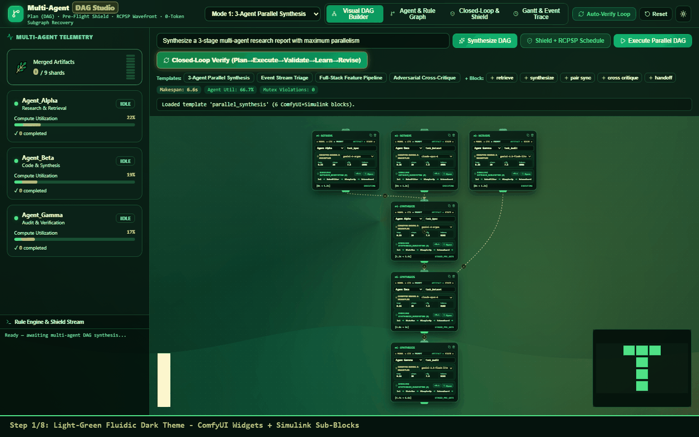
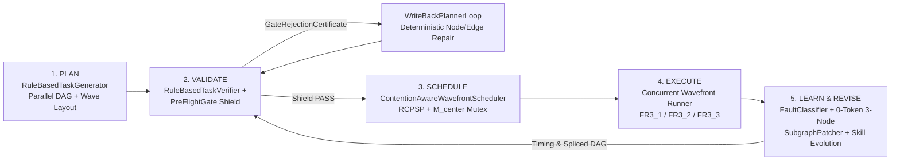
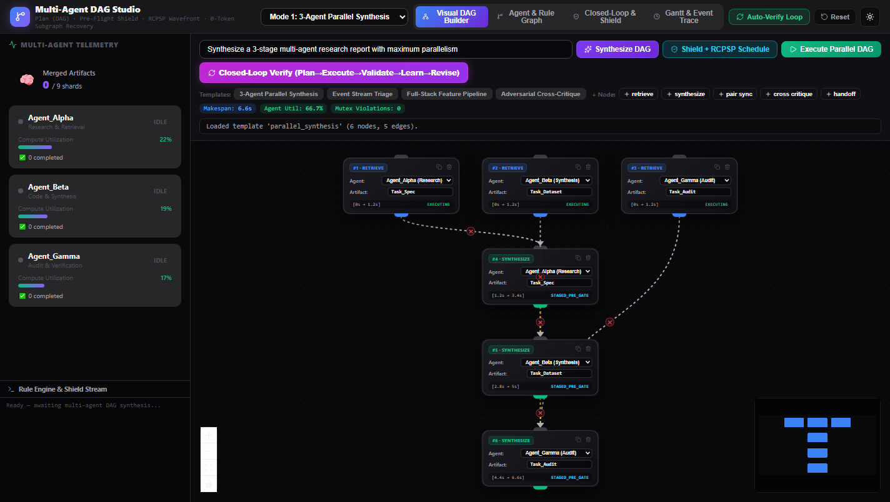
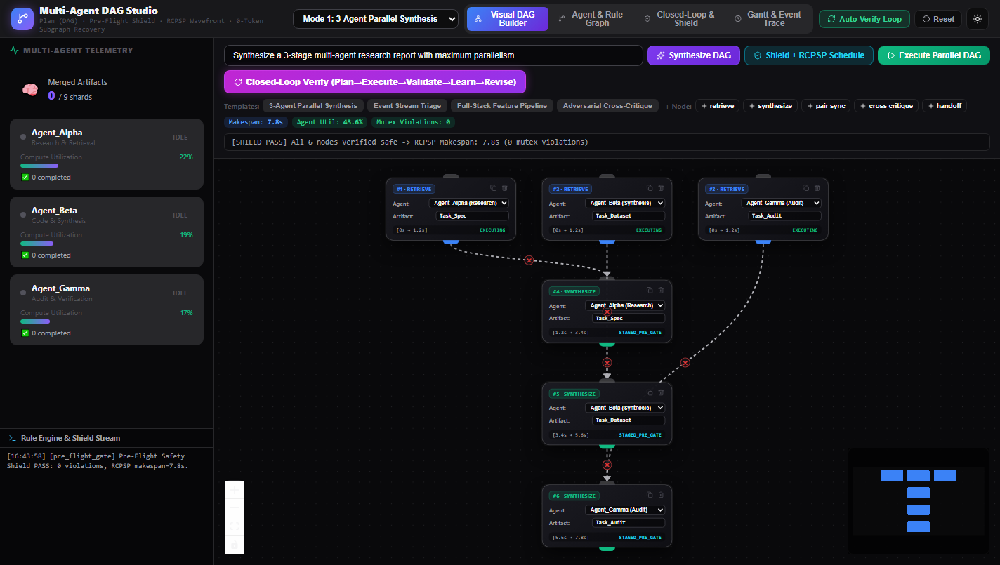
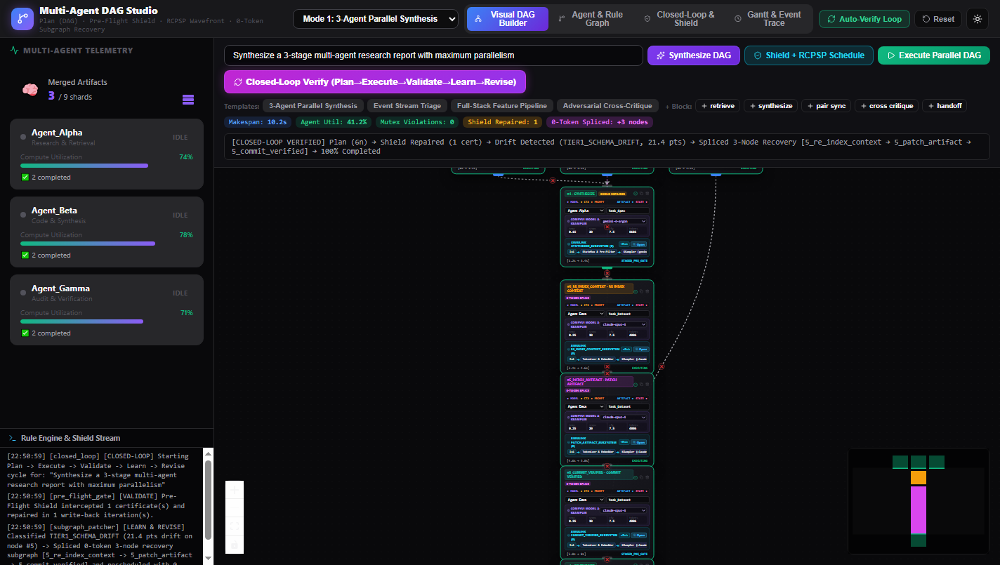
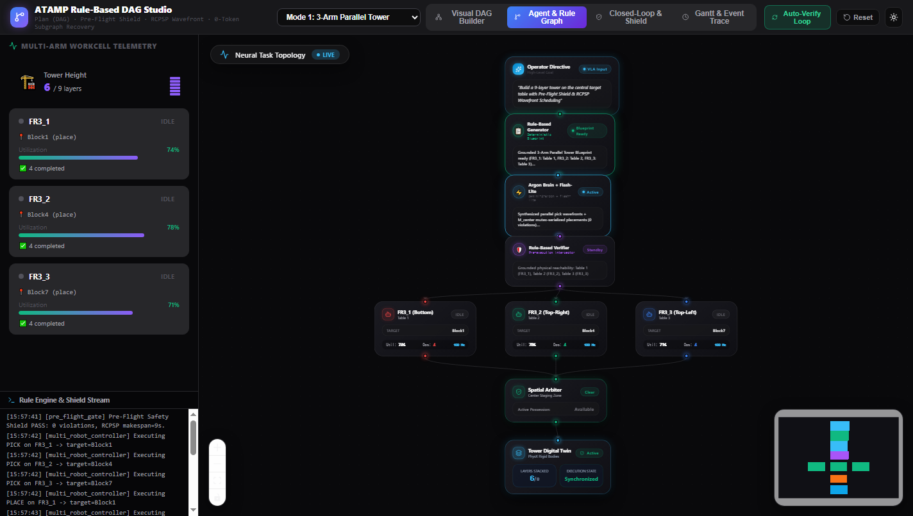
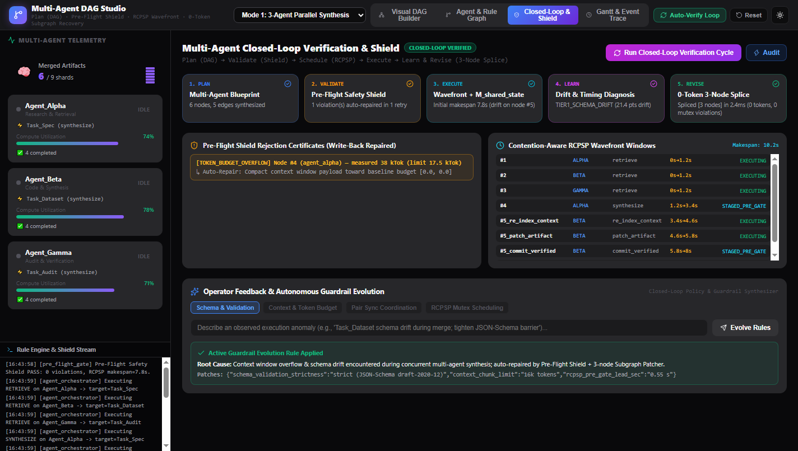
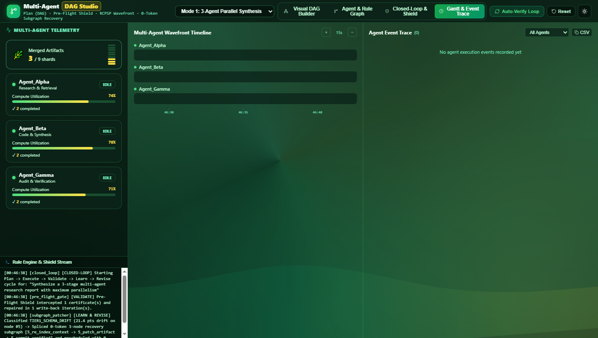
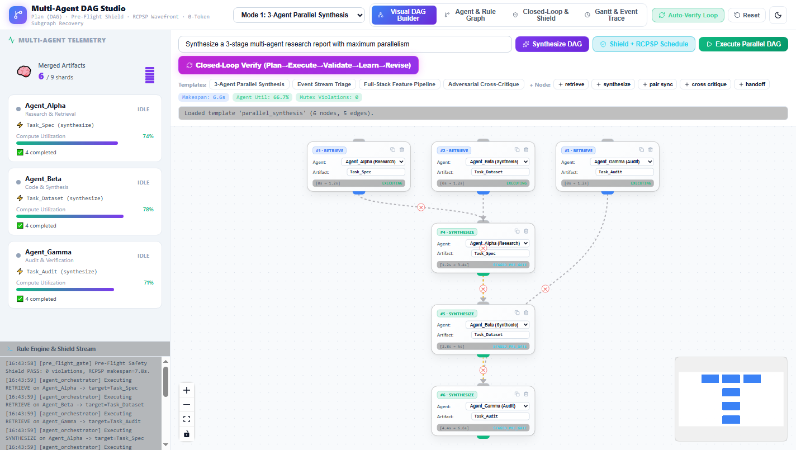

# ATAMP Rule-Based DAG Studio

Standalone **Rule-Based Directed Acyclic Graph (DAG) Engine, Closed-Loop Safety Verifier, Contention-Aware Wavefront RCPSP Scheduler, and React Flow v12 Monitoring Studio** for Multi-Robot Agentic Task and Motion Planning (ATAMP).



---


## Live GCP Cloud Run Deployment (PoC)

- **Live Service URL**: [**https://atamp-dag-studio-533179078347.asia-northeast3.run.app**](https://atamp-dag-studio-533179078347.asia-northeast3.run.app)
- **GCP Project / Region**: `jplt-511713` / `asia-northeast3` (`atamp-dag-studio`)

### Deploy or Update on GCP Cloud Run
```powershell
# Build dist/ and deploy to Google Cloud Run (asia-northeast3)
.\deploy.ps1

# Check live Cloud Run revision status, /api/status health, and recent logs
.\status.ps1
```

---

## Core Closed-Loop Architecture (`Plan -> Validate -> Schedule -> Execute -> Learn & Revise`)



### Key Modules

| Layer | File | Responsibilities |
|---|---|---|
| **Rule-Based DAG Engine** | `src/engine/ruleEngine.ts` | `RuleBasedTaskGenerator`, `RuleBasedTaskVerifier`, `PreFlightGate`, `WriteBackPlannerLoop`, `MutexProfileStore`, `ContentionAwareWavefrontScheduler`, `FaultClassifier`, `SubgraphPatcher`, `FeedbackEvolutionEngine`, `ClosedLoopOrchestrator`, `autoLayoutDag` |
| **Monitoring & Simulation Backend** | `server.cjs` | Express REST + Server-Sent Events (`GET /api/logs`) server on `:3001` providing rule-based DAG synthesis, Pre-Flight Shield validation, RCPSP wavefront scheduling, simulated 50Hz multi-arm step execution, and one-click closed-loop verification (`POST /api/closed-loop/run`) |
| **Visual DAG Builder** | `src/components/VisualWorkflowBuilder.tsx` | Interactive `@xyflow/react` v12 canvas with custom `TaskActionNode`, `RemovableEdge`, parallel/bimanual/conveyor templates, Pre-Flight Shield & RCPSP schedule badges, concurrent wavefront runner, and one-click Closed-Loop Auto-Verify |
| **Agent & Rule Supervision Graph** | `src/components/AgentWorkflowGraph.tsx` | Live `@xyflow/react` v12 architectural graph of `Operator Directive -> Rule-Based Generator -> VLA/Planner -> Rule-Based Verifier -> FR3_1..3 -> Spatial Mutex Arbiter -> Digital Twin` |
| **Closed-Loop & Shield Inspector** | `src/components/ClosedLoopMonitor.tsx` | 5-stage closed-loop verification ledger (`1. PLAN -> 2. VALIDATE -> 3. EXECUTE -> 4. LEARN -> 5. REVISE`), `GateRejectionCertificate` inspector, RCPSP Wavefront Windows table, and Operator Feedback & Skill Evolution synthesizer |
| **Wavefront Gantt & Event Trace** | `src/components/GanttChart.tsx`, `src/components/EventTrace.tsx`, `src/components/KpiDashboard.tsx` | Real-time multi-arm (`FR3_1`, `FR3_2`, `FR3_3`) Gantt timeline, sortable/filterable event trace with CSV export, and live workcell KPI sidebar |

---

## How to Use

### 1. Prerequisites
- **Node.js** `>= 20` or **Bun** `>= 1.3`

### 2. Install Dependencies
```bash
cd D:\git\DAG
bun install
# or: npm install
```

### 3. Run the Closed-Loop Test Suite
```bash
bun test
```
Runs 11 unit and integration suites (76 assertions) covering:
1. **Plan**: Rule-based blueprint & parallel topological wave layout (`autoLayoutDag`) across 3-Arm Tower, 50Hz Conveyor, Flexible Basket, Bimanual LongBar, and STAMP Workcell V2 SDL modes.
2. **Validate**: `RuleBasedTaskVerifier` bimanual auto-promotion & SDL tilt/temperature guardrails + `PreFlightGate` & `WriteBackPlannerLoop` auto-repair of `COM_OVERHANG`, `IK_OUT_OF_BOUNDS`, and `SWEPT_VOLUME_COLLISION`.
3. **Schedule**: `ContentionAwareWavefrontScheduler` (`greedy` vs `rcpsp`) with `STAGED_PRE_GATE` pre-positioning, zero `mutex_violations` on `M_center`, and empirical timing write-back.
4. **Learn & Revise**: `FaultClassifier` Tier-1 local pose slip detection (`3mm < slip < 50mm`) + `SubgraphPatcher` 0-token 3-node recovery splice (`re_perceive_pose -> regrasp_offset -> replace_verified`) + `FeedbackEvolutionEngine`.
5. **Backend REST & Topological Non-Overlap**: End-to-end verification of all Express endpoints and non-overlapping wave layout after 3-node subgraph splicing.

### 4. Start the Backend & Frontend Studio

#### Option A: Development Mode (Vite HMR on `:5173` + Express API on `:3001`)
```bash
# Terminal 1 — Start the Rule-Based DAG & Digital Twin Server (:3001)
node server.cjs

# Terminal 2 — Start the Vite React Flow Frontend (:5173)
bun run dev
```
Open **http://localhost:5173** in your browser.

#### Option B: Single-Port Production Build (`:3001`)
```bash
bun run build
node server.cjs
```
Open **http://localhost:3001** in your browser.

---

## Interactive Workflow Walkthrough

### Step 1: Visual DAG Builder & Rule-Based Synthesis
Type a natural-language task directive (or choose a preset template: **3-Arm Parallel Tower**, **50Hz Conveyor Stream**, **Flexible Basket Packing**, **Bimanual LongBar Wave**) and click **Synthesize DAG**.


### Step 2: Pre-Flight Safety Shield & RCPSP Wavefront Scheduling
Click **Shield + RCPSP Schedule** to validate all node coordinates against kinematic reachability (`[150mm, 850mm]`), static Center-of-Mass overhang (`>= 5mm` margin), and central-zone AABB collisions, while computing the contention-aware RCPSP wavefront schedule.


### Step 3: Closed-Loop Auto-Verify (`Plan -> Execute -> Validate -> Learn -> Revise`)
Click **Closed-Loop Verify (Plan→Execute→Validate→Learn→Revise)** to run the automated closed loop:
- **Validate**: Intercepts an injected `38mm` CoM overhang on Node `#4` and auto-repairs it via `WriteBackPlannerLoop` (`SHIELD REPAIRED` badge).
- **Learn & Revise**: Detects a `21.4mm` local pose slip (`TIER1_LOCAL_POSE_SLIP`) on Node `#5` and splices a **0-token 3-node recovery subgraph** (`#5_re_perceive_pose -> #5_regrasp_offset -> #5_replace_verified`) directly into the DAG while preserving zero mutex violations.


### Step 4: Multi-Agent & Rule-Based Supervision Graph
Switch to the **Agent & Rule Graph** tab to inspect the live supervision topology connecting the Operator Directive, Rule-Based Generator, Orchestrator, Rule-Based Verifier, `FR3_1..3` arms, and Spatial Mutex Arbiter.


### Step 5: 5-Stage Closed-Loop & Shield Inspector
Switch to the **Closed-Loop & Shield** tab to inspect the 5-stage verification cards, Pre-Flight Gate Rejection Certificates, Contention-Aware RCPSP Wavefront Windows, and Operator Feedback & Autonomous Guardrail Evolution console.


### Step 6: Multi-Arm Gantt Timeline, Event Trace & Clean Light Theme
Switch to **Gantt & Event Trace** to monitor real-time arm concurrency and export CSV traces, or toggle the **Dark / Light Theme** button in the top-right header.



---

## REST API Reference (`server.cjs`)

| Endpoint | Method | Description |
|---|---|---|
| `/api/status` | `GET` | Returns current workcell telemetry, Shield counters, monitoring summary, and recent closed-loop reports |
| `/api/logs` | `GET` | Server-Sent Events (SSE) stream for live logs, robot metrics, and closed-loop events |
| `/api/workflow/generate` | `POST` | Synthesizes a rule-based parallel DAG from `{ prompt, mode }` with RCPSP schedule |
| `/api/workflow/validate` | `POST` | Runs `PreFlightGate` + `WriteBackPlannerLoop` + `ContentionAwareWavefrontScheduler` on `{ nodes, edges }` |
| `/api/workflow/execute-step` | `POST` | Executes a DAG node in the simulated 50Hz Digital Twin workcell with `M_center` mutex arbitration |
| `/api/closed-loop/run` | `POST` | Runs a full `Plan -> Execute -> Validate -> Learn -> Revise` cycle with optional fault injection |
| `/api/feedback` | `POST` | Synthesizes root cause, parameter patches, and guardrail rules from operator feedback |
| `/api/reset` | `POST` | Resets Digital Twin workspace state, robot counters, and Shield telemetry |
