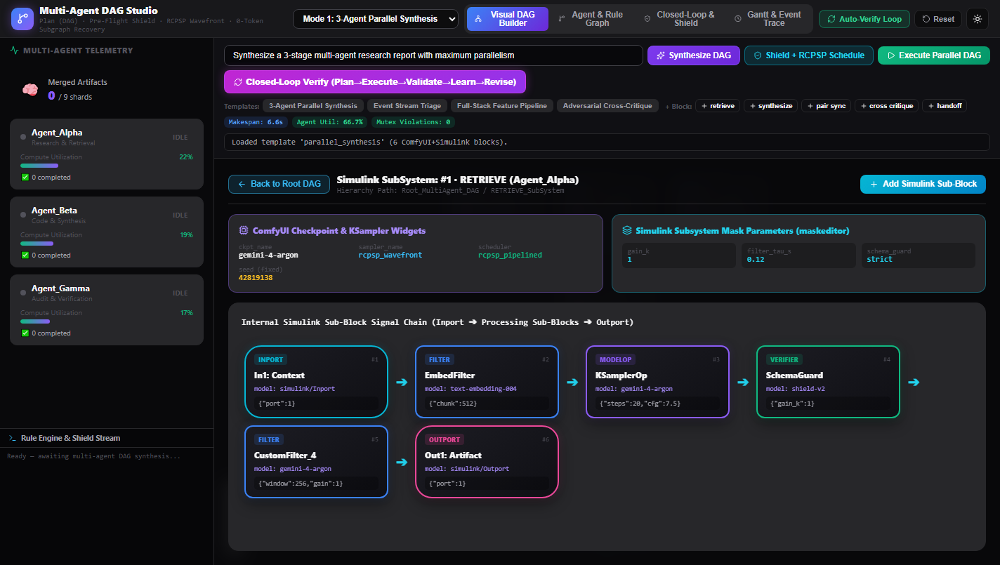
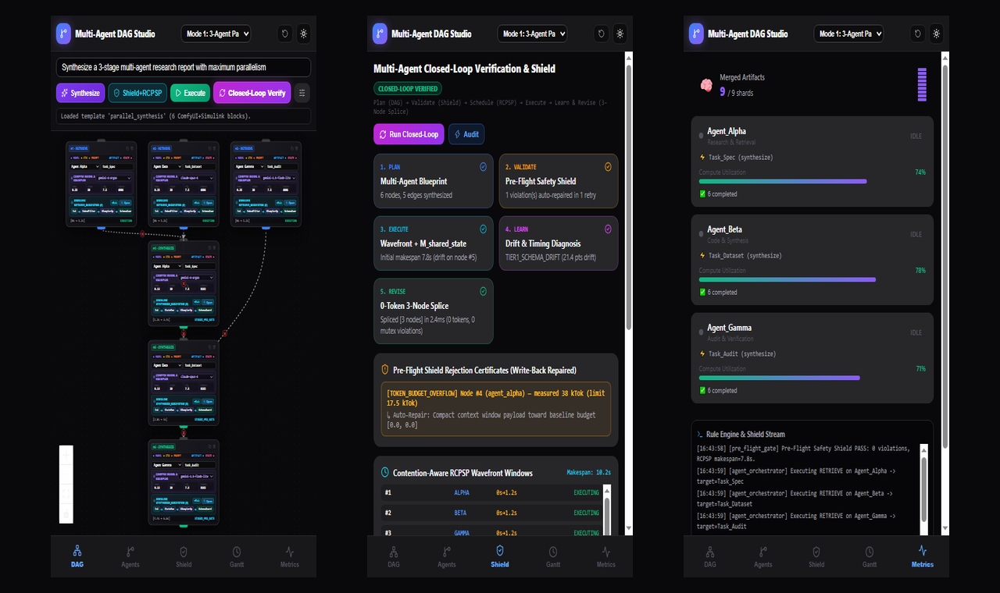
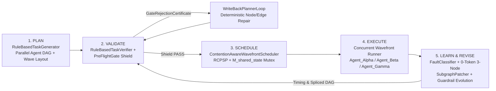

# Multi-Agent Rule-Based DAG Studio

Standalone **Rule-Based Multi-Agent Directed Acyclic Graph (DAG) Engine, Closed-Loop Pre-Flight Safety Shield, Contention-Aware Wavefront RCPSP Scheduler, and Mobile + Desktop React Flow v12 Studio** for Multi-Agent Orchestration.


---

## Live GCP Cloud Run Deployment (Desktop & Mobile Ready)

- **Live Service URL**: [**https://atamp-dag-studio-533179078347.asia-northeast3.run.app**](https://atamp-dag-studio-533179078347.asia-northeast3.run.app)
- **Regional Alias URL**: [**https://atamp-dag-studio-kkwxezedia-du.a.run.app**](https://atamp-dag-studio-kkwxezedia-du.a.run.app)
- **GCP Project / Region**: `jplt-511713` / `asia-northeast3` (`atamp-dag-studio`)

```powershell
# Build dist/ and deploy to Google Cloud Run (asia-northeast3)
.\deploy.ps1

# Check live Cloud Run revision status, /api/status health, and recent logs
.\status.ps1
```

---


## ComfyUI Model/Parameter Widgets & Simulink Hierarchical Sub-Blocks

Every DAG block combines **ComfyUI** node ergonomics with **Simulink R2023b** hierarchical `SubSystem` design:

1. **ComfyUI-Style Typed Sockets & KSampler Widgets**:
   - **Color-Coded I/O Pins**: `● MODEL` (`#a78bfa`), `● CTX` (`#fbbf24`), `● PROMPT` (`#fb923c`), `ARTIFACT ●` (`#38bdf8`), and `STATE ●` (`#f472b6`).
   - **Inline Model & Parameter Controls**: Per-node `model_checkpoint` selector (`gemini-4-argon`, `gemini-3.5-flash-lite`, `claude-opus-4`, `gpt-5-codex`, `deepseek-r1`), `temp`, `steps`, `cfg`, `tokens`, `seed` (`fixed` / `increment` / `randomize`), `sampler_name` (`rcpsp_wavefront`), and `scheduler` (`rcpsp_pipelined`).
2. **Simulink-Style Hierarchical Sub-Blocks (`SubSystem` Inside a Block)**:
   - **Inline Sub-Block Chain**: Each block renders its internal connected sub-block pipeline (`[In1] ➔ [EmbedFilter / StateMux] ➔ [KSamplerOp] ➔ [SchemaGuard] ➔ [Out1]`) directly inside the node card, with a **`+Sub`** button to insert new internal gain/filter stages on the fly.
   - **Interactive Subsystem Drill-Down (`🔍 Open`)**: Clicking **`🔍 Open`** drills into the block's internal Simulink `SubSystem` diagram (`Root_MultiAgent_DAG / RETRIEVE_SubSystem`), exposing **Simulink Mask Parameters** (`gain_k`, `filter_tau_s`, `schema_guard`) and the full internal `Inport ➔ Sub-Blocks ➔ Outport` chain.



---

## Mobile-First & Desktop Responsive UX

On mobile viewports (`< 768px`, e.g. iPhone `390x844`), the interface automatically switches to a full-width mobile layout with:
- **Sticky 5-Tab Bottom Navigation Bar**: `DAG`, `Agents`, `Shield`, `Gantt`, and `Metrics` (moving the desktop telemetry & log sidebar into a dedicated full-screen tab so the DAG canvas has 100% viewport width).
- **Compact Action Header & Toggleable Node Palette**: Maximizes vertical React Flow canvas space on phone screens while keeping one-tap access to **Synthesize**, **Shield+RCPSP**, **Execute**, and **Closed-Loop Verify**.
- **Auto-Fit & Touch Controls**: Automatically fits the multi-agent DAG to mobile screen bounds and hides the desktop MiniMap overlay.



---

## Core Closed-Loop Multi-Agent Architecture (`Plan -> Validate -> Schedule -> Execute -> Learn & Revise`)



### Specialist Agents & Actions

- **Agents**:
  - `Agent_Alpha` — Research & Context Retrieval Specialist (`Task_Spec`, `Task_Schema`, `UI_Wireframe`, `API_Contract`)
  - `Agent_Beta` — Code Synthesis & Transformation Specialist (`Task_Dataset`, `Task_Code`, `Task_Model`, `PII_Compliance_Shard`)
  - `Agent_Gamma` — Audit, Security & Verification Specialist (`Task_Audit`, `Task_Bench`, `Task_Deploy`, `Telemetry_Rule`)
  - `Agent_Alpha+Agent_Beta` — Collaborative Pair Mode (`SharedSchemaContract`, `FeatureIntegrationBundle`)
- **Actions**:
  - `retrieve`: Parallel context/shard retrieval across independent specialist agents
  - `synthesize`: Artifact synthesis & commit to the Shared Knowledge Store (serialized on `M_shared_state`)
  - `pair_sync`, `cross_critique`, `pair_commit`: Collaborative dual-agent design, adversarial critique, and synchronized commit
  - `re_index_context -> patch_artifact -> commit_verified`: **0-Token 3-Node Recovery Subgraph** spliced automatically upon `TIER1_SCHEMA_DRIFT`

---

## How to Use Locally

### 1. Install Dependencies & Run Tests
```bash
cd D:\git\DAG
bun install
bun test
```

### 2. Start Backend & Frontend Studio
```bash
# Option A: Development Mode (Vite HMR on :5173 + Express API on :3001)
node server.cjs
bun run dev

# Option B: Single-Port Production Build (:3001)
bun run build
node server.cjs
```

---

## Interactive Workflow Walkthrough

### Step 1: Visual Multi-Agent DAG Builder & Rule-Based Synthesis


### Step 2: Pre-Flight Safety Shield & RCPSP Wavefront Scheduling


### Step 3: Closed-Loop Auto-Verify (`Plan -> Execute -> Validate -> Learn -> Revise`)
Intercepts `TOKEN_BUDGET_OVERFLOW` on Node `#4` via `WriteBackPlannerLoop` (`SHIELD REPAIRED`) and repairs `TIER1_SCHEMA_DRIFT` on Node `#5` by splicing the 3-node recovery subgraph (`#5_re_index_context -> #5_patch_artifact -> #5_commit_verified`).


### Step 4: Multi-Agent & Rule-Based Supervision Graph


### Step 5: 5-Stage Closed-Loop & Shield Inspector


### Step 6: Multi-Agent Gantt Timeline, Event Trace & Clean Light Theme


